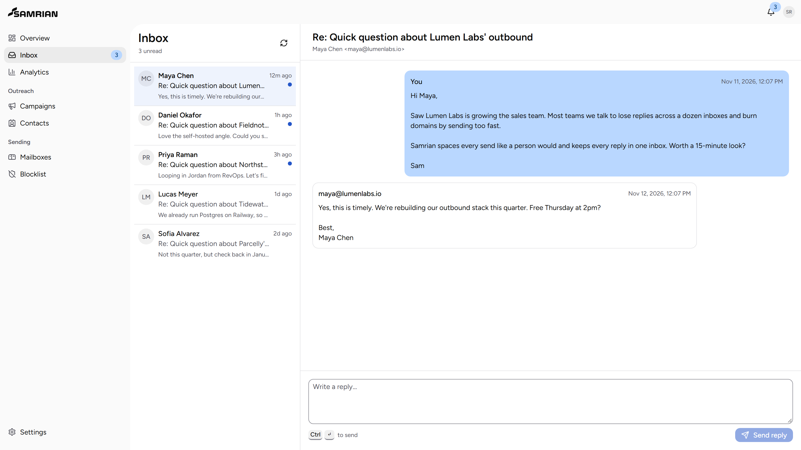
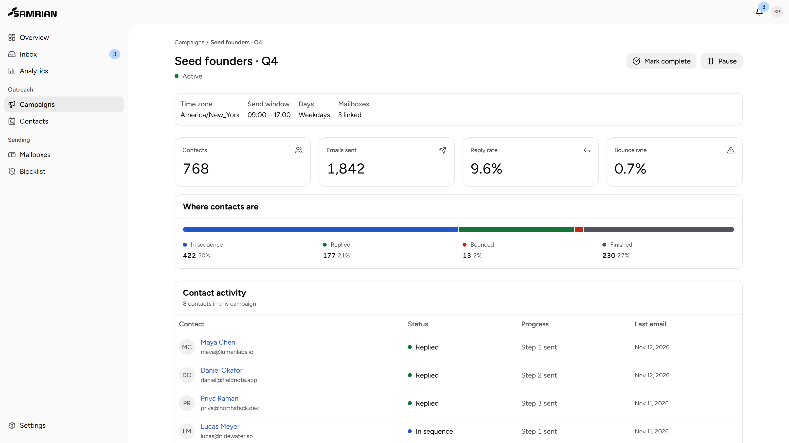
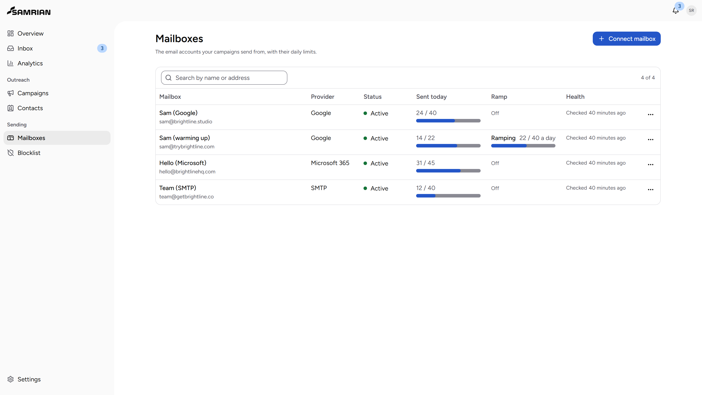
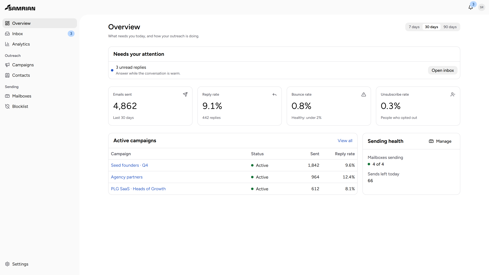

<div align="center">
  <picture>
    <source media="(prefers-color-scheme: dark)" srcset="docs/assets/samrian-wordmark-light.svg">
    <source media="(prefers-color-scheme: light)" srcset="docs/assets/samrian-wordmark-dark.svg">
    
  </picture>

  <h3>The open-source cold email platform you can actually self-host.</h3>

  <p>Campaigns, mailboxes, and every reply in one inbox. One Next.js app and one Postgres database.</p>

  <p>
    <a href="#self-host"><strong>Self-host</strong></a> ·
    <a href="docs/DEPLOYMENT.md"><strong>Docs</strong></a> ·
    <a href="CONTRIBUTING.md"><strong>Contribute</strong></a>
  </p>

  <p>
    <a href="LICENSE"></a>
    <a href="https://github.com/AfizFaysel/Samrian-Cold-Email/actions/workflows/ci.yml"></a>
    
    
  </p>
</div>

<p align="center">
  
</p>

## Why Samrian

Cold email tools are rented. Your mailboxes, contacts, and every reply live on someone else's
servers, priced per seat. Samrian is the same workflow as open source: run it on your own Postgres,
keep your data, and change anything.

It is small on purpose. One Next.js app, one database, and a job runner (Inngest, or a BullMQ
worker on any VPS). If you can deploy a web app, you can run your own cold email platform.

## Features

- **Sends like a person.** Every mailbox waits a random 90 seconds to 7 minutes between emails,
  sends at most 8 an hour, and warms up gradually toward its daily limit.
- **Sequences that run themselves.** Multi-step campaigns send in each contact's time zone and stop
  the moment someone replies.
- **One inbox for every reply.** Replies from all your mailboxes land in one place, ready to answer.
  Bounces, unsubscribes, and auto-replies are sorted out for you.
- **Google, Microsoft, or any SMTP.** Connect mailboxes with sign-in or an app password, and see
  their health and daily capacity at a glance.
- **Compliance built in.** One-click unsubscribe headers, a physical address footer, a blocklist,
  and automatic pauses when bounce or complaint rates climb.
- **Built for teams and agents.** Roles and permissions, scoped API keys, a typed SDK, a CLI, and an
  MCP server so AI agents can run campaigns safely.

<table>
  <tr>
    <td width="50%">
      <picture>
        <source media="(prefers-color-scheme: dark)" srcset="docs/assets/screenshot-inbox-dark.png">
        
      </picture>
      <p align="center"><sub>Every reply, one inbox</sub></p>
    </td>
    <td width="50%">
      <picture>
        <source media="(prefers-color-scheme: dark)" srcset="docs/assets/screenshot-campaign-dark.png">
        
      </picture>
      <p align="center"><sub>Campaigns that report where every contact is</sub></p>
    </td>
  </tr>
  <tr>
    <td width="50%">
      <picture>
        <source media="(prefers-color-scheme: dark)" srcset="docs/assets/screenshot-mailboxes-dark.png">
        
      </picture>
      <p align="center"><sub>Mailboxes with daily limits and warm-up</sub></p>
    </td>
    <td width="50%">
      <picture>
        <source media="(prefers-color-scheme: dark)" srcset="docs/assets/screenshot-overview-dark.png">
        
      </picture>
      <p align="center"><sub>What needs you today, at a glance</sub></p>
    </td>
  </tr>
</table>

## Self-host

**Docker on any VPS.** Runs the app, Postgres, Redis, and the sending worker:

```bash
bun run env:init
docker compose up -d --build
```

`env:init` writes `.env` with generated secrets, and migrations run before the app starts. Set
`NEXT_PUBLIC_APP_URL` to your public address before building for a server.

**Managed.** Vercel, a managed Postgres such as Neon, and Inngest. See
[`docs/DEPLOYMENT.md`](docs/DEPLOYMENT.md), which also covers how often jobs run on each setup.

## Development

```bash
bun install
cp .env.example .env.local
bun run db:test:up
bun run queue:test:up
bun run db:migrate
bun run dev
```

Open `http://localhost:3000`. Common checks:

```bash
bun run validate
bun run test
bun run test:db
bun run build
```

### Stack

- Next.js 16, React 19, TypeScript, and the Astryx design system
- PostgreSQL with Drizzle ORM and row-level security per organization
- Better Auth or WorkOS for sign-in and organizations
- Inngest for managed jobs, or BullMQ and Redis on a VPS
- Optional S3-compatible object storage

### Architecture

Runtime code depends on app-owned seams, not provider SDKs:

```txt
UI / route handlers / workers
  -> server modules
  -> repos / queue / storage / crypto / auth ports
  -> provider adapters
```

| Path          | Contents                                         |
| ------------- | ------------------------------------------------ |
| `src/app/`    | Next.js routes and UI                            |
| `src/server/` | Modules, jobs, ports, repos, and adapters        |
| `packages/`   | Public contracts, SDK, CLI, and MCP server (MIT) |
| `tests/`      | Unit, contract, repo, API, and component tests   |
| `docs/`       | Development and deployment guides                |
| `drizzle/`    | Generated migrations                             |

Read [`docs/DEVELOPMENT.md`](docs/DEVELOPMENT.md) before changing behavior.

## License

Samrian application and server code are licensed under Apache-2.0. Public contracts, SDK, CLI, and
MCP packages are licensed under MIT. See [LICENSING.md](LICENSING.md) for exact component
boundaries and [TRADEMARKS.md](TRADEMARKS.md) for brand-use guidance.

## Community

- Read [CONTRIBUTING.md](CONTRIBUTING.md) before proposing changes.
- Follow [CODE_OF_CONDUCT.md](CODE_OF_CONDUCT.md) in project spaces.
- Report vulnerabilities privately as described in [SECURITY.md](SECURITY.md).
- Review pending public changes in [CHANGELOG.md](CHANGELOG.md).
